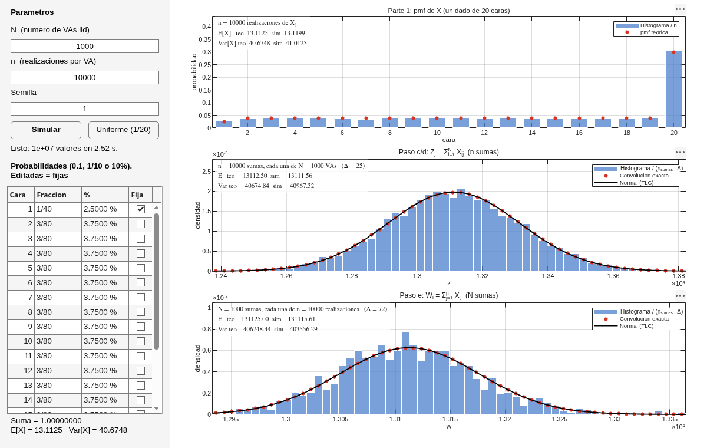

# Dado de 20 caras: suma de VAs y Teorema del Límite Central

Trabajo 1 de Sistemas y Procesos Estocásticos (Universidad de Cuenca).
Distribución elegida: **uniforme discreta** en {1,…,20}, un dado de 20 caras con probabilidades editables.



## Qué hace
- **Parte 1:** n realizaciones de X, histograma dividido para n y pmf teórica encima.
- **Paso c/d:** matriz X de N×n. Al sumar a lo largo de las VAs salen n sumas de N dados. Se compara con la convolución exacta y con la normal N(Nμ, Nσ²).
- **Paso e:** al sumar a lo largo de las realizaciones salen N sumas de n valores. Se compara con N(nμ, nσ²).

## Cómo ejecutar
Requiere MATLAB R2021b o posterior, sin toolboxes. Usa `backgroundPool` para correr en varios núcleos.

Desde la carpeta del proyecto, en MATLAB:
```matlab
dado20_app        % interfaz gráfica
informe_dado20    % genera figura_dado20.png sin abrir la interfaz
pruebas_dado20    % pruebas automáticas
```

Para abrir solo la ventana de la aplicación, sin el escritorio de MATLAB:
```bash
matlab -nodesktop -nosplash -r "dado20_app"
```

En la tabla de probabilidades se puede escribir `0.1`, `1/10` o `10%`. La cara editada queda fija y las caras libres se reacomodan para que todo sume 1.

## Archivos
| Archivo | Función |
|---|---|
| `dado20_app.m` | Interfaz gráfica (figure + uicontrol) |
| `lanzar_simulacion.m`, `recoger_simulacion.m` | Simulación por bloques en paralelo (asíncrona) |
| `simular_dado.m` | Versión síncrona para scripts |
| `pmf_suma.m` | pmf exacta de la suma: convolución N-veces vía FFT |
| `parsear_prob.m`, `rebalancear_prob.m` | Entrada de probabilidades y reajuste de las demás caras |
| `crear_graficas.m`, `actualizar_graficas.m` | Gráficas |
| `informe_dado20.m` | Figura para el informe |
| `pruebas_dado20.m` | Pruebas (también corren en GitHub Actions) |
